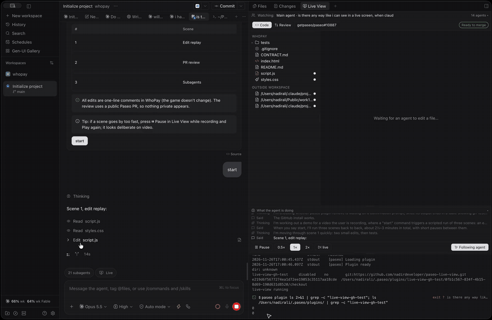
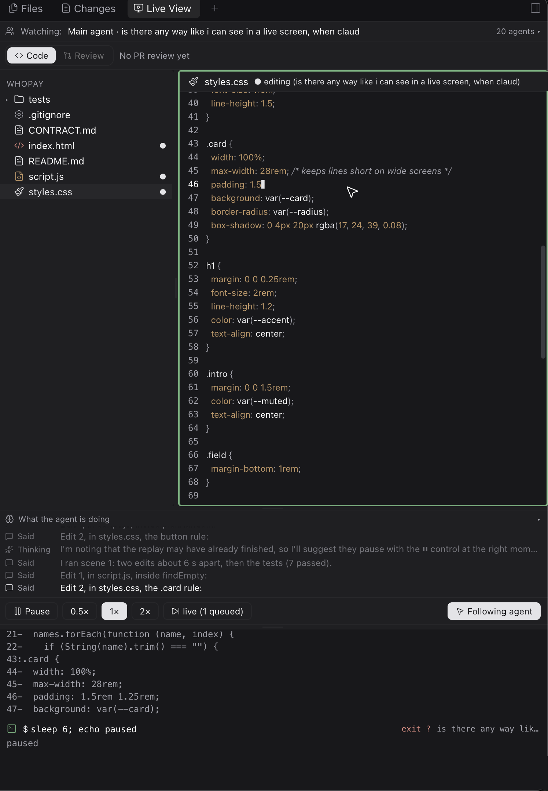
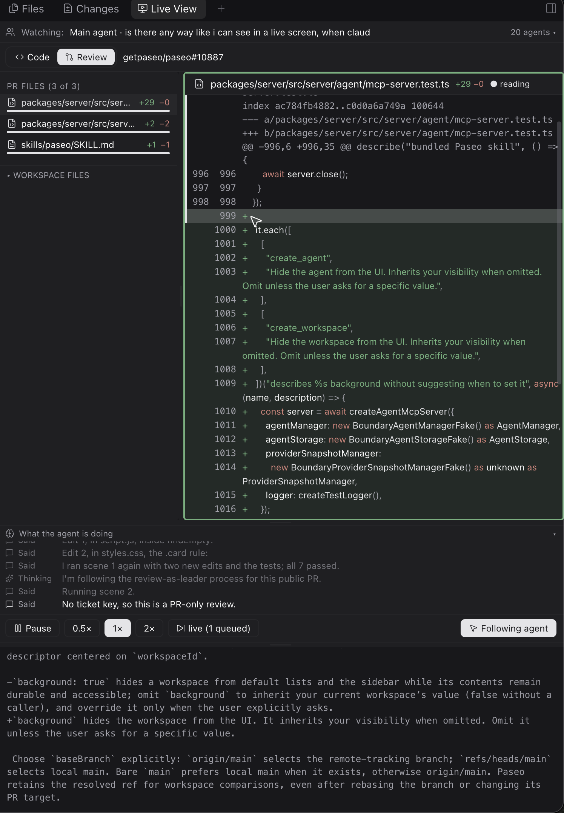
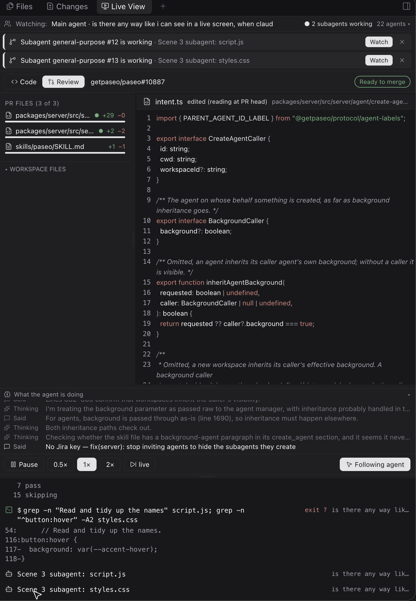

# Live View for Paseo

Watch your [Paseo](https://paseo.sh) agents work like a VS Code screen. Live View is a Paseo panel that replays what agents do — file edits with a moving pointer and typing cursor, every shell command and its output, pull-request reviews with findings pinned on the code, the agent's thinking — and gives each Claude Code subagent its own replay.



<sub>1.5× speed. [Full-quality MP4](assets/demo.mp4)</sub>

| Edit replay | Review mode | Subagents |
| --- | --- | --- |
|  |  |  |

## Features

- **Edit replay.** The pointer clicks the file in the tree, then the line; the change is typed in with a cursor, syntax-coloured, and highlighted. Replays run in slow motion when things are calm and speed up so they stay within about 15 seconds of the agent.
- **Terminal.** Every command the agent runs, typed out, with its output and exit code.
- **Every read and write.** Files read with `cat`, `head`, `tail`, `sed -n`, `grep`, `rg`, `awk`, `bat`, the Read and Grep tools or MCP file tools open in the editor with a reading highlight on the lines read; Glob results light up in the file tree. Files changed by shell commands (`python3 - <<'EOF'`, `sed -i`, `perl -pi`, `cat >`, scripts), MultiEdit, NotebookEdit or other tools are typed in like any other edit.
- **Review mode.** When an agent reviews a PR (`gh pr diff`, follow-up reads of a saved diff, whole files fetched at the PR head), Live View switches to a diff view with a reading highlight, a "read so far" bar per file, and the final findings pinned under their lines with a verdict badge. A Code / Review switch lets you flip at any time.
- **Thinking strip.** The agent's reasoning and messages as short one-line steps.
- **Subagents.** Each Claude Code subagent gets its own replay. Live View stays on the main agent; a notice with a **Watch** button appears while a subagent works, and a "Watching" dropdown lists the main agent, its subagents and theirs.
- **Live pill.** A "Live" button in every agent's composer opens Live View beside the chat.
- Resizable panes, light and dark themes, and a tabbed layout for narrow windows and mobile.

## Requirements

- Paseo **0.17.4** or later, with plugins enabled on the daemon.
- Subagent replay works with Claude Code subagents. Other providers' subagents appear as a summary card.

## Install

From the Paseo plugin registry (once listed): open **Settings → Plugins**, search for **Live View**, and install it.

From source:

```bash
git clone https://github.com/nadirdeveloper/paseo-live-view.git
paseo plugin install "$PWD/paseo-live-view" --id live-view
paseo plugin ls   # live-view should show "running"
```

Open it from the Command Center (⌘K → **Open Live View**) or with the **Live** pill in an agent's composer.

## Privacy

Live View is read-only. It does not edit files, run commands or send data anywhere. It reads:

- the activity of the agents in the current workspace, which Paseo already has;
- files inside the workspace folder, to show the file list and the text around each edit. To show edits made by shell commands, it keeps an in-memory copy of the workspace's text files (each up to 1 MiB, 64 MiB in total) on your machine; it is never written to disk or sent anywhere;
- for Claude Code subagents, the subagent's own log and its small info file, only inside the project folder that matches the agent's working directory, in Claude Code config folders (`~/.claude`, `$CLAUDE_CONFIG_DIR`, and other `~/.claude-*` folders that contain a `projects` folder). It opens only logs that match a subagent the agent actually started.

## Development

```bash
pnpm install
pnpm test        # vitest: pure logic in client/logic and server/
pnpm typecheck
paseo plugin install "$PWD" --id live-view   # once, from this folder
paseo plugin reload live-view                # after each change
paseo plugin logs live-view                  # server-side output
```

Plugin code runs inside Paseo: client code uses React Native primitives only and colours from the Paseo theme; server code runs in the Paseo daemon. Pure logic lives in `client/logic/` and `server/` and is unit-tested.

| Path | What it is |
| --- | --- |
| `index.client.tsx` | Registers the panel, the Command Center item and the Live pill |
| `index.server.ts` | File list / read, subagent locate / tail handlers |
| `client/useLiveFeed.ts` | Follows every agent's timeline; one replay lane per agent and subagent |
| `client/logic/events.ts` | Agent timeline items → events, dedupe |
| `client/logic/player.ts`, `pacing.ts`, `pointer.ts` | Replay state machine, catch-up pacing, where the pointer goes |
| `client/logic/reconstruct.ts`, `highlight.ts`, `icons.ts` | Edit before-text, syntax colours, file icons |
| `client/logic/review/*` | Review mode: `gh` command detection, diff parsing, partial reads, findings, review state |
| `client/logic/thoughts.ts` | Thinking strip |
| `client/logic/subagents/*` | Subagent events, lanes, notices |
| `server/files.ts` | Workspace file listing and safe reads |
| `server/transcript.ts`, `server/subagents.ts` | Claude Code subagent logs: normalize, locate, tail |
| `client/*.tsx` | UI: editor, diff view, file tree, terminal, controls, switcher, notices |

## Contributing

Issues and pull requests are welcome. Please run `pnpm test` and `pnpm typecheck` before opening a PR, and keep client code React Native–only (no DOM APIs) so the panel works on mobile.

## Limitations

- Agents write each edit in one step, so edits are replayed shortly after they happen rather than streamed keystroke by keystroke.
- Syntax colours come from a small built-in tokenizer (JS/TS, JSON, CSS, HTML, Markdown, shell).
- Review mode shows only what the agent itself read; it never fetches from GitHub or Jira.

## License

[MIT](LICENSE)
